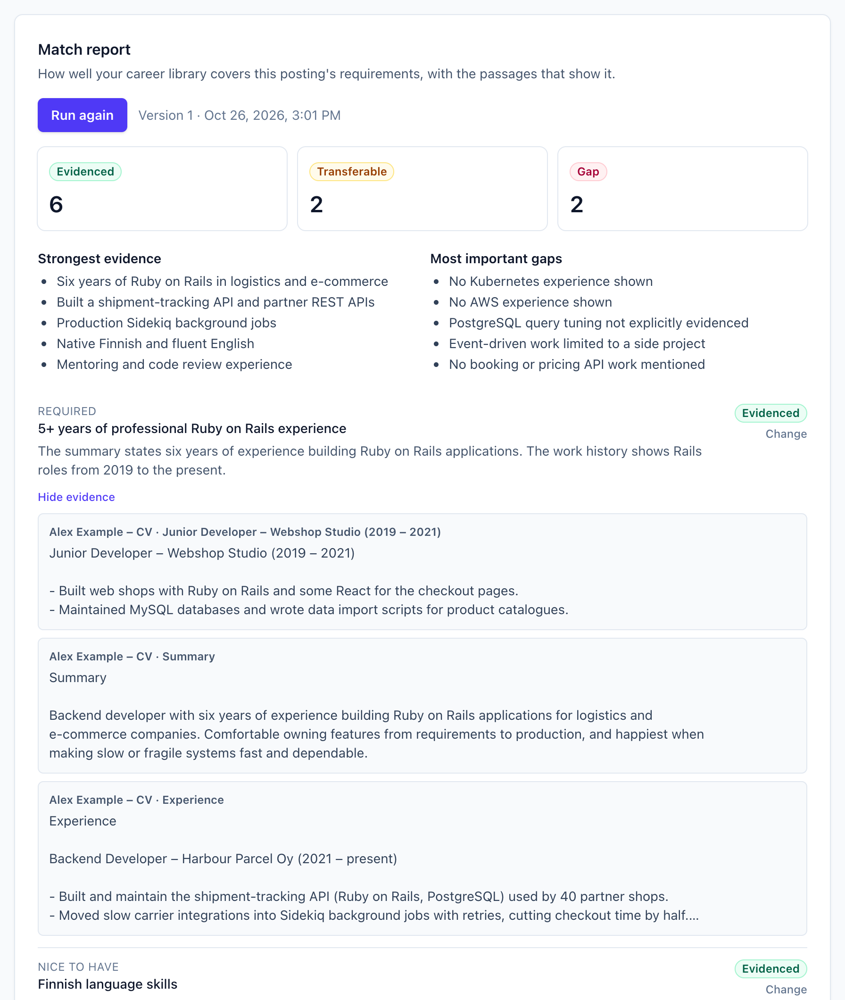
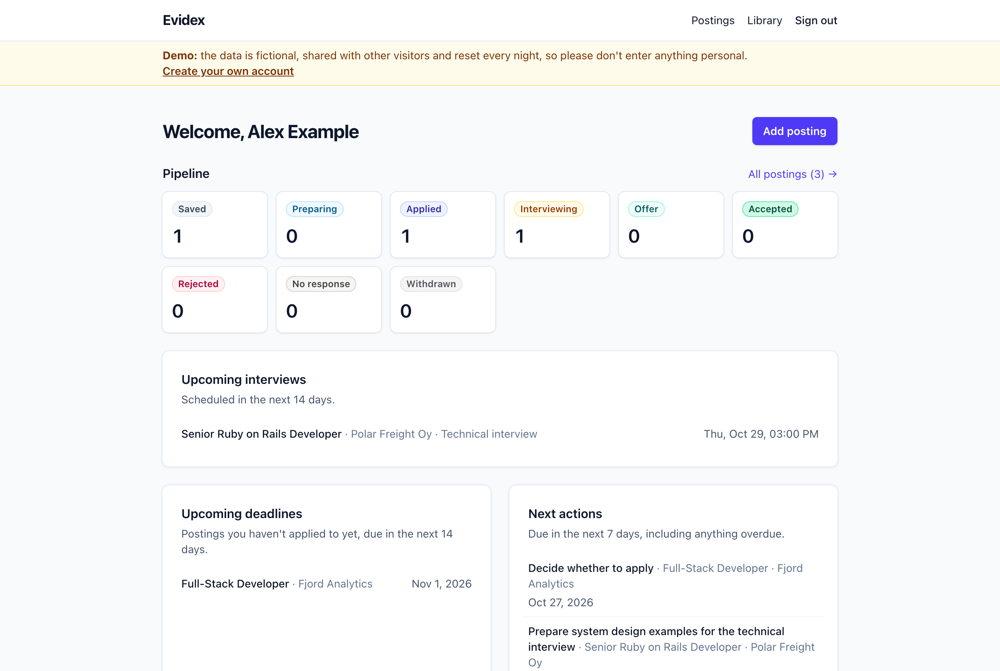
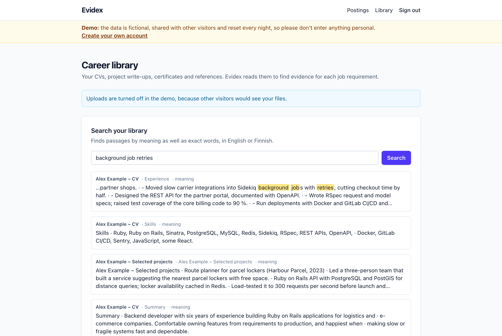
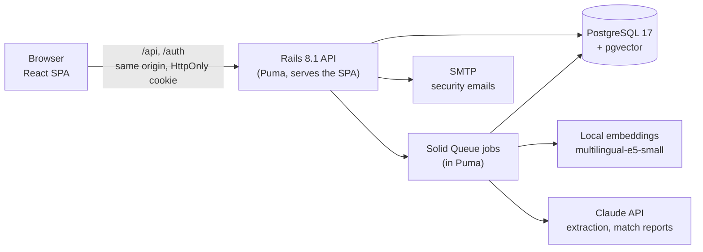

# Evidex

**Evidence-based job applications.** Evidex keeps track of the jobs you apply for
and checks every requirement in a job ad against your own CV and project
documents, so you know what you can prove before you write the application.

**Live:** https://evidex.henockmullissa.dev. Click **Try the demo, no sign-up**
to explore it with a fictional job seeker's data.



## What it does

- **Match report (RAG):** every requirement of a posting is judged *Evidenced*,
  *Transferable* or *Gap* by Claude, with citations to passages from your own
  documents. Citations are checked on the server; you can override any verdict
  and add notes, and earlier versions are kept.
- **Career library:** upload CVs and project write-ups (PDF, DOCX, Markdown,
  text). They are split into passages, embedded locally and searchable by
  meaning as well as exact words, in English or Finnish.
- **Job postings:** paste an ad or import it from a link (SSRF-safe fetching
  that reads schema.org `JobPosting` data). Claude fills in empty fields,
  requirements and keywords with structured outputs, and saving the same ad twice
  shows a warning.
- **Application tracking:** a status pipeline with a timeline, interviews,
  contacts, next actions and notes, plus a dashboard of deadlines and follow-ups.
- **Security:** email and password, Google and Microsoft sign-in, two-factor
  sign-in with recovery codes, re-authentication for sensitive changes, security
  emails and a personal activity log (details [below](#authentication-and-security-design)).
- **Admin area and public demo:** accounts, locks, audit log and AI cost per
  account for the admin, who never sees users' content; a shared demo account
  with fictional data that resets every night.

| Dashboard | Searching the career library |
|-----------|------------------------------|
|  |  |

## How the match report works

1. **Read and index the library.** Text is extracted from each document and split
   along headings and paragraphs (up to 2,000 characters, with a little overlap).
   Each passage is embedded in-process with a local open-source model
   (`multilingual-e5-small`, ONNX), so no document text goes to an embeddings API,
   and stored in PostgreSQL with pgvector.
2. **Retrieve evidence per requirement.** Hybrid search runs a vector similarity
   search and a PostgreSQL full-text search, both scoped to the user, and merges
   the two rankings with Reciprocal Rank Fusion. The best passages for all
   requirements are de-duplicated and numbered.
3. **One structured Claude call.** The requirements and passages go to Claude in
   delimited blocks that the prompt marks as data, not instructions (the model has
   no tools, so injected text can't act). A JSON schema forces one verdict, a short
   reasoning and the cited passage ids per requirement.
4. **Check before saving.** The server keeps only citations to passages it
   actually sent; an "evidenced" or "transferable" verdict without a valid citation
   is downgraded to "gap". Cited passages are stored as snapshots, so a report
   still reads correctly after a document changes.
5. **Cost control.** Reports run in background jobs, every AI call is recorded
   with its model, tokens and latency, and each account has a daily AI limit.

## Tech stack

| Layer | Choice |
|-------|--------|
| Backend | Ruby 4.0, Rails 8.1 (API mode) |
| Database | PostgreSQL 17 + pgvector |
| Jobs / cache / websockets | Solid Queue, Solid Cache, Solid Cable |
| AI | Anthropic Ruby SDK (Claude, structured outputs); local embeddings with `informers` (ONNX) |
| API docs | OpenAPI 3 generated from request specs (rswag) |
| Auth | `has_secure_password` (bcrypt), OmniAuth (Google, Microsoft Entra ID), TOTP (`rotp`), Rails rate limiting |
| Frontend | React 19 + TypeScript + Vite, React Router, TanStack Query, Tailwind CSS, in [`frontend/`](frontend) |
| API client | Typed with `openapi-typescript` + `openapi-fetch`, generated from the OpenAPI spec |
| Tests | RSpec, FactoryBot, WebMock, SimpleCov; Vitest + Testing Library |
| Quality | RuboCop (Rails Omakase), Brakeman, bundler-audit, oxlint, npm audit |
| CI / deploy | GitHub Actions; Docker image deployed with Kamal to a Hetzner server |

## Architecture



The SPA and the API share one origin (Vite proxies in development; Rails serves
the built SPA in production), so authentication uses secure `HttpOnly` session
cookies rather than tokens in browser storage. In production one Docker image runs
Rails, the SPA and the background jobs behind kamal-proxy (HTTPS with Let's
Encrypt), with PostgreSQL as a Kamal accessory on the same server.

## Authentication and security design

- **Server-side sessions.** The browser gets a random token in a signed `HttpOnly`,
  `SameSite=Lax` cookie (`Secure` in production). Only its SHA-256 digest is stored,
  so a database leak doesn't expose usable sessions. Sessions expire after 14 days
  idle or 30 days total, and users can see and revoke every signed-in device.
- **CSRF protection.** Every state-changing request needs the `X-CSRF-Token` header
  (from `GET /api/v1/csrf_token`). The Rails session is reset on sign-in to prevent
  session fixation.
- **No account enumeration.** Sign-in, registration and password reset respond
  identically whether or not an email is registered; the real owner gets an email.
- **Brute-force defence.** Per-IP rate limits on sensitive endpoints, plus per-account
  lockout after 5 failures (15 minutes, doubling up to 24 hours) with an email alert.
- **Password rules.** 12+ characters, bcrypt's 72-byte limit enforced, and passwords
  found in known breaches are rejected via the Have I Been Pwned range API
  (k-anonymity: only 5 characters of the SHA-1 hash leave the server).
- **Single-use, short-lived tokens.** Password reset links expire in 15 minutes and
  stop working once the password changes; email confirmation links expire in 24 hours.
  The SPA removes tokens from the address bar after reading them.
- **Safe Google/Microsoft linking.** OAuth starts with a CSRF-protected POST, never a
  GET link. An identity links to an existing account by email only when the provider
  says the email is verified (Google). Microsoft's email claim isn't guaranteed
  verified, so it never auto-links. When a verified Google sign-in claims an account
  whose email was never confirmed, that account's password and sessions are removed
  (pre-account-takeover defence).
- **Re-authentication.** Changing the password requires the current one; adding a
  first password to a Google/Microsoft-only account requires a sign-in within the
  last 10 minutes. Users can't remove their last sign-in method.
- **Two-factor sign-in.** Authenticator-app codes (TOTP with replay protection, the
  secret encrypted at rest) and ten single-use recovery codes stored as digests;
  Google and Microsoft sign-ins ask for the code too.
- **Audit trail.** Sign-ins, failures, lockouts, resets and linking are recorded,
  and users see their own activity with device and address.
- **Public demo.** The shared demo account can't change account settings, link
  sign-in methods or upload documents, has its own small AI allowance, and its
  sign-ins are kept out of the audit log so visitors never see each other's addresses.
- **Admin area.** Admin rights are granted only from the server
  (`bin/rails "evidex:admin:grant[email]"`), never through the API. The admin API
  answers 404 to everyone else and requires two-factor sign-in; locking, unlocking
  and signing out an account also need a sign-in from the last 10 minutes. Every
  admin action is recorded and shown on the affected user's activity page. Admin
  endpoints return account metadata only, and specs check that admins can't read
  anyone's documents, postings or reports.
- **Errors** follow RFC 9457 problem details (`application/problem+json`).

## Getting started

### Prerequisites

- Ruby 4.0.7 (see `.ruby-version`; e.g. `mise install`)
- PostgreSQL 17 with the [pgvector](https://github.com/pgvector/pgvector) extension
- Node.js 26 (see `frontend/.nvmrc`)

On macOS with Homebrew:

```bash
brew install mise postgresql@17 pgvector
brew services start postgresql@17
mise install
```

### Setup and run

```bash
bin/setup        # installs gems + npm packages, prepares the database, starts the app
bin/dev          # starts Rails (:3000) and Vite (:5173)
```

Open http://localhost:5173. API documentation is at http://localhost:3000/api-docs,
and emails sent in development open at http://localhost:3000/letter_opener.

### Configuration

Copy `.env.example` to `.env`. Everything works without it, except Google and Microsoft
sign-in, which appear only once their credentials are set:

- **Google**: create an OAuth client ID (Web application) in Google Cloud Console →
  APIs & Services → Credentials. Authorized redirect URI:
  `http://localhost:5173/auth/google_oauth2/callback`. Set `GOOGLE_CLIENT_ID` and
  `GOOGLE_CLIENT_SECRET`.
- **Microsoft**: register an app in the Microsoft Entra admin center → App registrations,
  with "Accounts in any organizational directory and personal Microsoft accounts".
  Add a Web redirect URI `http://localhost:5173/auth/entra_id/callback` and a client
  secret. Set `MICROSOFT_CLIENT_ID` and `MICROSOFT_CLIENT_SECRET`.
- **AI features**: set `ANTHROPIC_API_KEY` (from console.anthropic.com). Optional:
  `EVIDEX_AI_MODEL` (default `claude-opus-5-5`) and `EVIDEX_AI_DAILY_LIMIT` (default 20).
  Without a key the app works normally and hides the AI buttons.

### Demo account

The sign-in page offers **Try the demo** once a demo account exists. It is one
shared account with fictional data (a CV, a project write-up, three postings at
different stages and a saved match report) from [`db/demo`](db/demo):

```bash
bin/rails evidex:demo:reset   # create or rebuild it (no AI call)
```

In production it is rebuilt every night at 3:00 Helsinki time (`ResetDemoJob`).
Account settings and document uploads are locked in the demo, and its AI use is
capped by `EVIDEX_DEMO_AI_DAILY_LIMIT` (default 5 a day, shared by all visitors).
To refresh the saved match report after changing the demo data, run a report on
the first demo posting in the app and then `bin/rails evidex:demo:export_match_report`.

### Tests and checks

```bash
bin/ci                            # everything CI runs: lint, types, security scans, tests
bundle exec rspec                 # backend tests
npm test --prefix frontend        # frontend tests
bin/rails rswag:specs:swaggerize  # regenerate swagger/v1/swagger.yaml
npm run gen:api --prefix frontend # regenerate TypeScript API types from it
```

## API

The full, interactive reference is served at `/api-docs` (OpenAPI 3, generated from
the request specs). The frontend's API types are generated from the same file, and CI
fails if either drifts.

| Method | Path | Description |
|--------|------|-------------|
| GET | `/api/v1/csrf_token` | CSRF token for state-changing requests |
| GET | `/api/v1/auth/providers` | Enabled Google/Microsoft sign-in providers |
| POST | `/api/v1/registration` | Register with email and password |
| POST / DELETE | `/api/v1/session` | Sign in / sign out |
| POST | `/api/v1/email_verification` (`/resend`) | Confirm email / resend confirmation |
| POST / PATCH | `/api/v1/password_reset` | Request reset email / set new password |
| GET / DELETE | `/api/v1/me` | Current user / delete account |
| PATCH | `/api/v1/me/password` | Change or add a password |
| GET / DELETE | `/api/v1/me/sessions` (`/:id`, `/others`) | List and revoke signed-in devices |
| GET / DELETE | `/api/v1/me/identities` (`/:id`) | List and disconnect Google/Microsoft |
| POST | `/auth/:provider` | Start Google/Microsoft sign-in (browser form POST) |
| GET | `/up`, `/api/v1/status` | Health checks |

## License

[MIT](LICENSE)
